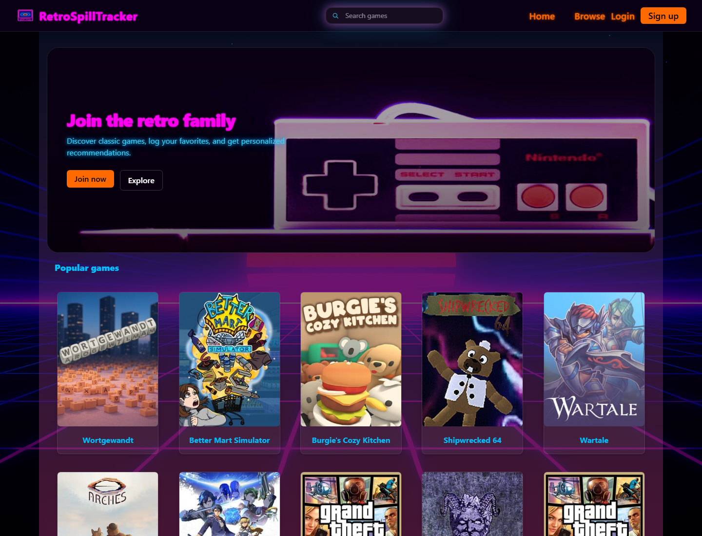
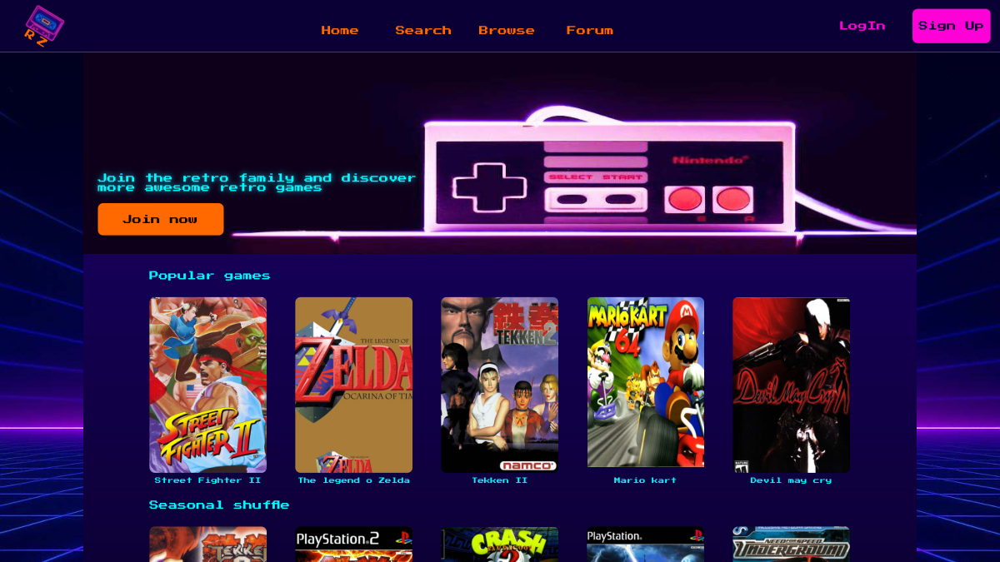
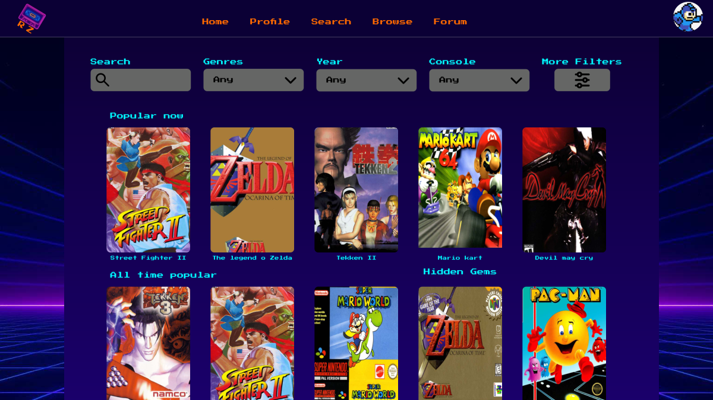
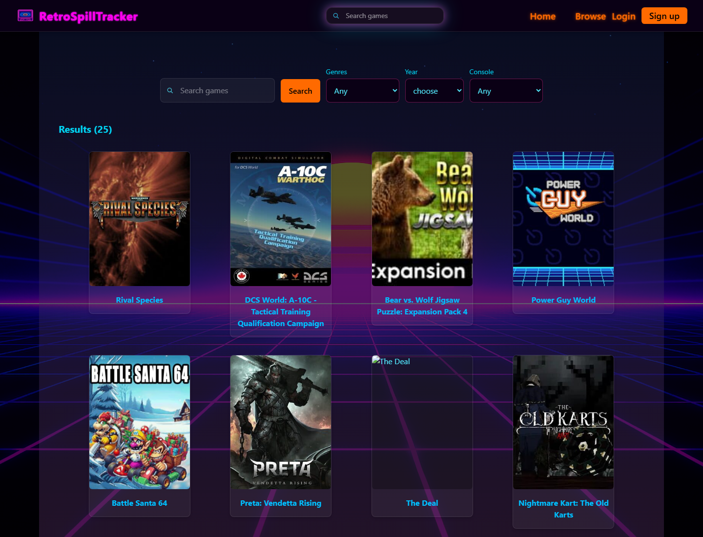

# RetroSpillTracker

A web portal for retro game enthusiasts and collectors: discover classic games, search the IGDB database, and keep track of what you are playing.

**Live demo:** https://retrospill-tracker.robertjohannessen.workers.dev

Group project in *Web Applications* at Østfold University College (autumn 2025), built by four students. This repository is my portfolio copy of the group's repository, set up to run as a live demo. See [My contribution](#my-contribution).



## Features
- **Popular games** on the front page, fetched live from the IGDB API
- **Game search** with filters for genre, release year and console, with up to 25 results per search
- **Game detail pages** with cover art and game information
- **Responsive layout** with a mobile hamburger menu and a search field in the header
- **User accounts and collections** (registration, login, profile, backlog). The database model and API are in place, but parts of the login flow were still in progress when the course ended.

## Tech stack
| Area | Technology |
|---|---|
| Framework | [RedwoodSDK](https://rwsdk.com) (React 19 with Server Components) |
| Language | TypeScript |
| Styling | Tailwind CSS 4 and custom CSS |
| Hosting | Cloudflare Workers |
| Database | Cloudflare D1 (SQLite) with Drizzle ORM |
| Validation | Zod |
| External API | IGDB (via Twitch) |
| Design | Figma |

## My contribution
I was responsible for **most of the visual design and the frontend**: I designed most of the Figma prototypes and built the pages, layout and styling that bring them to life.

**Design (Figma)**
- Designed most of the Figma prototypes: home, search, game detail and profile pages
- Created the visual identity: synthwave/retro theme, colour palette, neon typography and the grid background

**Frontend**
- **Layout:** the shared `Layout`, `Header` and `Footer` components, including Tailwind setup
- **Responsive header:** mobile hamburger menu (`MobileMenu`), a search field in the header and a custom search icon
- **Hero component:** reusable, with different background images per page and a parallax effect
- **Search page:** the first version with mock data, then connected to IGDB. Later refactored into a container that combines `useSearchResults`, `SearchForm` and `SearchResults`, with result limits and styling.
- **Game cards:** responsive cover images
- **Sign-up and login pages:** design, styling and form logic
- **Visual style:** most of the global stylesheet (`styles.css`) and the shared `Button` component

**By the numbers** (from `git blame` on the final code)
- **83 %** of the code in `src/app/pages`
- **70 %** of the shared UI components (`src/app/shared/components`)
- **92 %** of the global stylesheet
- 57 commits in total

The backend (database schema, API routes, authentication and IGDB integration) was mainly built by my teammates.

### From Figma to code
| Figma prototype | Live site |
|---|---|
|  |  |
|  |  |

More prototypes: [profile page](docs/images/figma-profile.png) · [game detail page](docs/images/figma-game-detail.png)

### Changes in this portfolio copy
To run the project as a public demo, I made these changes after the course:
- Removed API keys that had been committed to the original repository, from the whole Git history
- Made the app deployable to Cloudflare Workers (lazy database connection, Vite path aliases, relative API URLs)
- Fetch and refresh the Twitch/IGDB token automatically, so the demo doesn't stop working when the token expires
- Removed password hashes and email addresses from the public user API
- Locked the database seeding route in production

## Run locally
Requirements: Node 22 and pnpm.

```bash
pnpm install
cp .env.example .env    # fill in your own Twitch/IGDB keys
pnpm migrate:dev        # create the local database
pnpm dev
```

Open http://localhost:5173 and go to http://localhost:5173/seed to load test data.

To get IGDB keys, register an application at [dev.twitch.tv/console](https://dev.twitch.tv/console) and put the Client ID and Client Secret in `TWITCH_API_ID` and `TWITCH_API_SECRET`.

### Deploy to Cloudflare
```bash
pnpm exec wrangler d1 create retrospill-tracker   # put the database_id in wrangler.jsonc
pnpm migrate:prod
pnpm exec wrangler secret put TWITCH_API_ID
pnpm exec wrangler secret put TWITCH_API_SECRET
pnpm release
```

## Team
| | Name | GitHub |
|---|---|---|
|  | Anders Bergh | [@Lubbsaur](https://github.com/Lubbsaur) |
|  | Marius Rørmark | [@MaRoeIT](https://github.com/MaRoeIT) |
|  | **Robert Johannessen** | [@Robertjohiof](https://github.com/Robertjohiof) |
|  | Kjell-Magne Larsen | [@Sell-Mango](https://github.com/Sell-Mango) |

Original group repository: [Sell-Mango/RetrospillTracker](https://github.com/Sell-Mango/RetrospillTracker)
